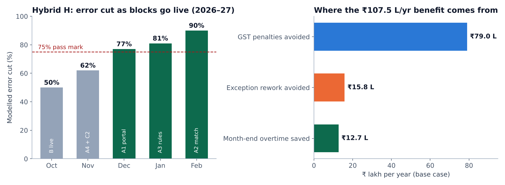

# Six Sigma Invoicing

**Break The Case '26 (BITS Hyderabad) · DMAIC model for supplier invoice errors**


The model behind our team's **Round 2** submission to **Break The Case '26** (BITS Hyderabad). The case: a renewable-energy company's back office in India receives too many supplier invoices with errors. Fixing them costs money, delays payments and triggers GST penalties. We were asked to act as Six Sigma consultants and run the full **DMAIC** cycle (Define, Measure, Analyse, Improve, Control).

This repo is the Python pipeline that analyses the case data, designs and stress-tests the solutions, and writes the 23-sheet Excel model we submitted.

---

## The short version

| | Baseline | Hybrid H (base case) |
|---|---|---|
| Errors per million fields (DPMO) | **10,648** (3.80σ) | **1,026** (4.58σ) |
| Invoices with any error | ≈ 46% | ≈ 5.8% |
| Invoices waiting 2+ days | 14% | 0% |
| Cost of poor quality | ₹105 L / year | ₹107.5 L / year **saved** |
| 3-year NPV · payback | – | **₹162 L · 9 months** |

**Root cause:** nothing checks an invoice when it is submitted. Three supplier-side reasons cause 75% of errors, and the month-end rush (3.8× normal volume, up to 170% of team capacity) makes it worse.

**How we chose the fix:** we designed three complete approaches, one per lever:

- **A · Digital Front Door** (technology): a supplier portal, 3-way matching and a rules engine
- **B · Lean Flow** (process): a triage desk, a month-end calendar and a flex pool
- **C · Supplier Partnership** (governance): scorecards, PO discipline and certification

Each one broke under stress-testing somewhere, so we split them into **15 building blocks**, searched **all 25,599 workable combinations**, ranked the shortlist under **3,000 random scenarios**, and stress-tested the finalists with **20,000 Monte Carlo runs**. The winner, **Hybrid H**, keeps 10 blocks and rolls out in phases, with go/no-go gates and a pre-set October decision rule for underperformance.



> **Honest range:** these are base-case figures. Across 20,000 simulated futures the median result is a 77% cut and ₹84 L NPV, and 1.8% of scenarios lose money. Costs are illustrative because the case gives no prices.

---

## Pipeline

```
run_all.py               runs every stage in order (--from / --to / --list / --verbose)
paths.py                 all folder locations in one place

01_analysis/             error rates, confidence intervals, regression, Pareto,
                         queueing and cost of poor quality on the 52 + 51 audit days  -> results.json
02_solutions/            what A, B and C each remove, cost and return; month-end queue -> sol.json
03_stress/               the 15 building blocks, 25,599-combination search, 3,000-scenario
                         ranking, 20,000-run Monte Carlo, 200-run queue simulations
04_statistics/           Laney u′ control chart, bootstrap / Poisson intervals,
                         the October go/no-go decision rule
05_workbook/             writes the 23-sheet Excel model (live formulas where possible)
```

Every random step uses a fixed seed, so a re-run reproduces the workbook numbers.

## Run it

```bash
pip install -r requirements.txt
# put the organisers' case workbook at data/original.xlsx (see data/README.md)
python run_all.py            # full pipeline, about 4–5 minutes
python run_all.py --list     # show the steps without running them
```

The finished workbook is written to `outputs/model2.xlsx`. If LibreOffice is installed, stage 5 also recalculates the formulas.

> The case workbook belongs to the competition organisers, so it isn't included here. Without it the scripts won't run, but the code reads top to bottom as documentation of the method.

## Methods used

DPU / DPMO / sigma level · Pareto and root-cause trees · Five Whys · fishbone · value-stream timing · discrete-event queue simulation · Poisson and negative-binomial GLMs · Laney u′ charts · exact Poisson and bootstrap intervals · NPV / payback · exhaustive combinatorial search · Monte Carlo stress-testing · decision-rule design under uncertainty

---

*Team entry, Break The Case '26 (Round 2). Code © 2026 Prathit Sharma and team, MIT licence. The case data and brief © the organisers.*
